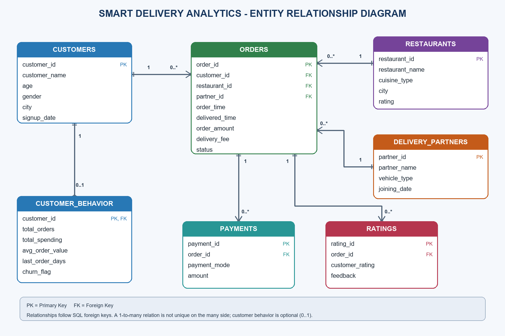

# Smart Delivery Analytics System

A MySQL analytics project exploring order fulfillment, delivery performance, cancellations, customer retention, and order value for a food-delivery platform. It combines a relational schema, CSV datasets, analysis queries, and query-result screenshots.

## Project at a glance

| Item | Details |
|---|---|
| Database | MySQL 8.0+ |
| Tools | MySQL Workbench, SQL, CSV |
| Dataset | 10,000 orders across 10 cities, January 2023–December 2024 |
| Core analysis | Delivery duration, cancellations, delivered order value, customer behavior, partner performance |
| SQL techniques | Joins, aggregates, subqueries, CTEs, window functions, views, stored procedures, indexes |

## Business questions

- How long do delivered orders take, and where might delivery operations need attention?
- What share of orders are cancelled, and how does that vary by city and restaurant?
- Which cities and restaurants contribute the most delivered order value?
- What do customer order history and the supplied churn indicator suggest about retention?
- How do delivery partner delivery times, completed-order volume, and customer ratings compare?

## Repository structure

```text
Smart_Delivery_Analytics/
├── README.md
├── Dataset/
│   ├── customers.csv
│   ├── restaurants.csv
│   ├── delivery_partners.csv
│   ├── orders.csv
│   ├── payments.csv
│   ├── ratings.csv
│   └── customer_behavior.csv
├── SQL/
│   ├── 01_create_tables.sql
│   ├── 02_data_validation_and_data_cleaning.sql
│   ├── 03_business_analysis.sql
│   └── 04_advanced_sql.sql
├── ER_Diagram/
│   └── ER_Diagram.png
├── Screenshots/
├── Reports/
│   ├── Business_Insights_Report.pdf
│   └── business_insights_report.md
├── LICENSE
└── .gitignore
```

The [ER diagram](ER_Diagram/ER_Diagram.png) reflects the columns and foreign-key relationships in the SQL schema. The Markdown report is the editable source for the [PDF report](Reports/Business_Insights_Report.pdf). The Screenshots folder contains the query-result evidence listed below.

## Data model

The schema contains seven related tables:

| Table | Grain / purpose |
|---|---|
| `customers` | One row per customer and their profile/location |
| `restaurants` | One row per restaurant and its location/cuisine |
| `delivery_partners` | One row per delivery partner |
| `orders` | One row per order, status, timestamps, and order amount |
| `payments` | Payment transactions associated with orders |
| `ratings` | Customer rating and feedback associated with orders |
| `customer_behavior` | Customer-level order, spend, recency, and churn attributes |

The order table links to customers, restaurants, and delivery partners. Payments and ratings link to orders; customer behavior links to customers.



## Run the project

1. Install MySQL 8.0+ and open MySQL Workbench.
2. Run [`01_create_tables.sql`](SQL/01_create_tables.sql) to create the database and tables.
3. Import the seven CSV files from `Dataset/` into their corresponding tables. Use the Table Data Import Wizard or an equivalent CSV import workflow, and preserve the declared column order and data types.
4. Run [`02_data_validation_and_data_cleaning.sql`](SQL/02_data_validation_and_data_cleaning.sql) to inspect row counts, nulls, duplicates, and order foreign-key references.
5. Run [`03_business_analysis.sql`](SQL/03_business_analysis.sql) for the core business questions.
6. Run [`04_advanced_sql.sql`](SQL/04_advanced_sql.sql) to explore advanced queries, views, procedures, and indexes.

The import step is manual: this repository does not currently include a CSV loading script. Some objects in the advanced script are created with `CREATE VIEW` / `CREATE PROCEDURE`; if re-running it in the same database, remove the existing object or adapt the creation statements to your MySQL version and workflow.

## Findings from the included data

These are descriptive results calculated from the checked-in CSVs, not claims about a live delivery business:

- **Order outcomes:** 8,197 delivered (81.97%), 1,195 cancelled (11.95%), and 608 pending (6.08%) out of 10,000 orders.
- **Delivery duration:** delivered orders average **54.79 minutes** from `order_time` to `delivered_time`; 3,424 (41.77%) take more than 60 minutes. Sixty minutes is an exploratory benchmark only; the dataset does not define an SLA or promised ETA.
- **Cancellations by city:** Delhi has the highest observed cancellation rate at **13.29%** (147 of 1,106 orders). Kolkata is next at 13.15%. Rates are descriptive and do not explain why orders were cancelled.
- **Delivered order value:** delivered orders sum to **6,414,646.55 amount units** using `orders.order_amount`. The source does not specify a currency. This is not profit or net platform revenue.
- **Customer behavior:** 350 of 1,000 customers have `churn_flag = 1` (35%). Treat this as a supplied dataset label; its business definition is not documented.
- **Ratings:** the 7,000 available ratings average **2.99 / 5**. Ratings are present for 70% of orders; unrated orders should not be assumed to have a neutral rating.

For methodology, rankings, caveats, and recommended follow-up, see the [Business Insights Report](reports/business_insights_report.md).

## SQL coverage

- Relational table design and foreign keys
- Data validation queries
- Joins and conditional aggregates
- Subqueries and `EXISTS`
- Common Table Expressions (CTEs)
- Window functions: `ROW_NUMBER`, `RANK`, `DENSE_RANK`, `LAG`, and `LEAD`
- Views and stored procedures
- Indexes and `EXPLAIN`

## Query screenshots

| Topic | Screenshot |
|---|---|
| Tables and schema setup | [`01_show_tables.jpg`](Screenshots/01_show_tables.jpg) |
| Data validation | [`02_data_validation.jpg`](Screenshots/02_data_validation.jpg) |
| Delivery duration | [`03_delivery_delay_analysis.jpg`](Screenshots/03_delivery_delay_analysis.jpg) |
| Cancellations | [`04_cancellation_analysis.png`](Screenshots/04_cancellation_analysis.png) |
| Revenue / order value | [`05_revenue_analysis.png`](Screenshots/05_revenue_analysis.png) |
| Customer retention | [`06_customer_retention.png`](Screenshots/06_customer_retention.png) |
| Partner performance | [`07_partner_performance.png`](Screenshots/07_partner_performance.png) |
| CTEs and window functions | [`08_cte_queries.png`](Screenshots/08_cte_queries.png), [`09_window_functions.png`](Screenshots/09_window_functions.png) |
| Views and procedures | [`10_views_procedures.png`](Screenshots/10_views_procedures.png), [`11_procedures.png`](Screenshots/11_procedures.png) |

## GitHub project description

> MySQL food-delivery analytics project exploring 10K orders across delivery duration, cancellations, order value, customer retention, and partner performance using CTEs, window functions, views, procedures, and indexes.

## Resume project description

**Smart Delivery Analytics System | MySQL, SQL**

- Analyzed 10,000 food-delivery orders across seven relational datasets to evaluate delivery duration, cancellation patterns, delivered order value, customer behavior, and partner performance.
- Built reusable SQL analyses using joins, aggregates, subqueries, CTEs, window functions, views, and stored procedures; used indexes and `EXPLAIN` to demonstrate query optimization.
- Identified an 11.95% cancellation rate, a 54.79-minute average delivered-order duration, and a 35% supplied churn-flag rate; documented metric definitions and data limitations.

## LinkedIn project description

I built a MySQL analytics project to investigate operational and customer trends in a food-delivery dataset. The work covers 10,000 orders and seven related tables, with analysis of delivery duration, cancellations, order value, retention indicators, and delivery partner performance. I used joins, CTEs, window functions, views, stored procedures, and indexes, and documented the findings with clear metric definitions and data caveats. The checked-in sample shows an 11.95% cancellation rate and a 54.79-minute average delivery duration for delivered orders. These are descriptive dataset findings, not benchmarks for a live business.

## Interview explanation

> “Smart Delivery Analytics is a MySQL project I built to turn food-delivery order data into operational and customer insights. I modeled customers, restaurants, delivery partners, orders, payments, ratings, and customer behavior, then used SQL to analyze delivery duration, cancellations, order value, retention indicators, and partner performance. I applied joins and aggregations for the core metrics, CTEs and window functions for ranking and customer-level comparisons, and views and stored procedures for reusable outputs. In the included 10,000-order dataset, 81.97% of orders are delivered and the average elapsed time for delivered orders is 54.79 minutes. I also found an 11.95% cancellation rate and a 35% supplied churn-flag rate. I treated those as descriptive results, checked the source encodings, and called out that the data has no SLA or documented churn definition, so the results guide further investigation rather than establish causation.”

### Key business takeaways to discuss

1. **Fulfillment:** quantify delivery duration and segment it by location, restaurant, and partner; compare to an agreed ETA/SLA before calling it late.
2. **Cancellations:** use rates as well as counts. Delhi and Kolkata have the highest observed city rates, so investigate cancellation reason, time, restaurant, and fulfillment stage before prescribing a fix.
3. **Order value:** report completed-order value separately from all placed orders, payments, and profit. The dataset does not provide costs or a currency definition.
4. **Retention:** 35% of customers carry the supplied churn flag. Validate how that label was generated before building segments or estimating a retention campaign’s impact.
5. **Partner performance:** compare delivery duration and customer ratings with order volume and operating context; raw averages alone may not be fair performance rankings.

## Author

SHAIK NABI RASOOL
